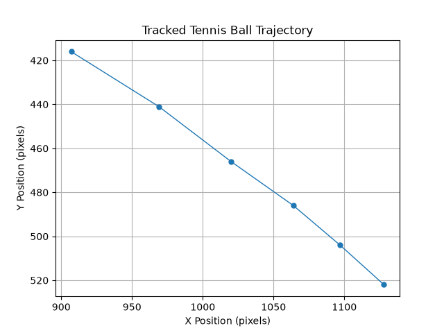

# Tennis Ball Tracking & Speed Estimation

An experimental computer vision project built with Python and OpenCV to detect and track tennis balls in video footage, map court landmarks, and analyze ball movement.

## Features

- Detects tennis balls using HSV color filtering and contour detection.
- Tracks ball positions across video frames.
- Calibrates court landmarks using perspective transformation.
- Exports tracked coordinates to CSV.
- Visualizes ball trajectories.
- Experiments with estimating ball speed from video footage.

## Project Structure

| File | Purpose |
|---|---|
| `ball_tracker.py` | Detects and tracks tennis balls in video footage. |
| `court_calibration.py` | Maps image coordinates to court coordinates using perspective transformation. |
| `get_points.py` | Collects court reference points for calibration. |
| `find_serve_frames.py` | Helps identify serve frames in video footage. |
| `speed_calculation.py` | Calculates image-plane ball speed. |
| `speed_estimator.py` | Experiments with ground-plane projected speed estimation. |
| `plot_trajectory.py` | Generates visualizations of tracked ball trajectories. |

## Technologies

- Python
- OpenCV
- NumPy
- Pandas
- Matplotlib

## Installation

Clone the repository:

```bash
git clone YOUR_REPOSITORY_URL
cd TennisProject
```

Install dependencies:

```bash
pip install -r requirements.txt
```

## Usage

1. Place your tennis video in the project directory.
2. Run the appropriate Python script to begin ball tracking.
3. Select the court reference points when prompted.
4. Review the exported tracking coordinates and trajectory visualization.

## Current Limitations

This project is an ongoing experiment.

- Ball detection can produce false positives or miss frames.
- Tracking accuracy depends on lighting, video quality, and camera positioning.
- Court perspective transformation maps points onto the court plane. Since a tennis ball travels through the air, this projection does not establish its true three-dimensional trajectory.
- Speed estimates are experimental and have not been validated against radar measurements. They should not be interpreted as actual serve speeds.

## Project Status

Alpha — core detection, tracking, court calibration, CSV export, and trajectory visualization are implemented. Accuracy improvements and further validation remain ongoing.
## Example Output

